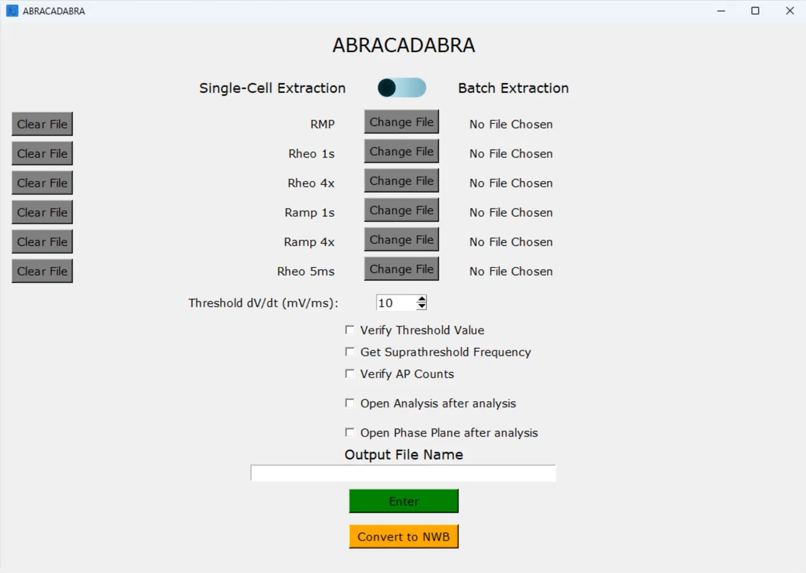

# ABRACADABRA
Axon Binary Reading Analyzer Capable of Analyzing Data as an Axon Binary Reading Analyzer

A user-friendly automated electrophysiology feature extractor for whole-cell current-clamp recordings


[](LICENSE)




---

## Table of Contents
- [Description](#description)
- [Requirements](#requirements)
- [Installation](#installation)
- [Supported Protocols](#supported-protocols)
- [Usage](#usage)
- [Output](#output)
- [Feature Definitions](#feature-definitions)
- [NWB Conversion](#nwb-conversion)
- [Help](#help)
- [Version History](#version-history)
- [Citation](#citation)
- [Authors](#authors)
- [License](#license)
- [Acknowledgments](#acknowledgments)

---

## Description
ABRACADABRA offers a high-throughput standardized analysis of current-clamp recordings in the .abf format. It will output CSV files with features extracted from each protocol along with SVG files of traces that were extracted. This was developed in the Copits Lab at Washington University School of Medicine.

## Requirements
- Python 3.11
- Tested on Windows 11 (macOS and Linux are untested)
- Supports ABF1 and ABF2 files
- Current-clamp recordings only

## Installation

### Windows executable
Download the latest .exe from the [Releases page](https://github.com/KesavK236/ABRACADABRA/releases).
The first time you run it, Windows Defender SmartScreen may show a "Windows protected your PC" warning because the app isn't code-signed. Click **More info**, then **Run anyway**.

### From source
```bash
git clone https://github.com/KesavK236/ABRACADABRA.git
cd ABRACADABRA
# optional: create a virtual environment
pip install -r requirements.txt
```

### Running
```bash
python main.py
```
<!-- Note: can also be run from an IDE -->

## Supported Protocols
<!-- Add sweep requirements / stimulus parameters per protocol if needed -->

| Protocol | Description | Features |
|---|---|---|
| RMP | A single sweep of membrane voltage with no current injected. | [RMP features](#rmp) |
| Rheo 1s | A series of 1s current steps until an AP is evoked. Can start at a hyperpolarizing current. | [Rheo 1s features](#rheo-1s) |
| Rheo 4x | A series of suprathreshold depolarizing current steps starting at the rheobase. | [Rheo 4x features](#rheo-4x) |
| Ramp 1s | A series of 1s ramping current injections until an AP is evoked. Can start at a hyperpolarizing current. | [Ramp 1s features](#ramp-1s) |
| Ramp 4x | A series of suprathreshold ramping current injections starting at the rheobase. | [Ramp 4x features](#ramp-4x) |
| Short Rheo 5ms | A series of 5ms current steps until an AP is evoked. | [Short Rheo 5ms features](#short-rheo-5ms) |

## Usage

### Basic analysis
1. Launch ABRACADABRA.
2. For each protocol you want to analyze, click **Change File** and select the corresponding .abf file.
3. To remove a file from the analysis, click **Clear File** to the left of it.
4. Set **Threshold dV/dt (mV/ms)** (default 10 mV/ms; any integer from 1 to 100). This is the rate of voltage change that defines the AP threshold.
5. Select any optional checkboxes:
   - **Verify Threshold Value** — see [Verifying threshold](#optional-verifying-threshold)
   - **Get Suprathreshold Frequency** — for every sweep after rheobase, counts the APs and calculates the mean interspike interval (ISI) and the coefficient of variation (CV) of the ISI. Works with Rheo 1s, Ramp 1s, and Rheo 5ms.
   - **Verify AP Counts** — see [Verifying AP counts](#optional-verifying-ap-counts)
   - **Open Analysis after analysis** — opens the CSV automatically when the analysis finishes
   - **Open Phase Plane after analysis** — automatically opens the phase plane CSV (see [Output](#output)) when the analysis finishes
6. Enter a name in **Output File Name**.
7. Click **Enter** to run the analysis. Results are saved to `<name>_outputs` in the same directory as ABRACADABRA.

### Batch extraction
To analyze many recordings at once, flip the switch at the top of the window from **Single-Cell Extraction** to **Batch Extraction**. The **Change File** buttons then select a folder instead of a single file, and every .abf file in that folder is analyzed as that protocol.

**Before running, organize your files into one folder per protocol.** Each folder should contain only recordings of a single protocol. ABRACADABRA does not filter files by protocol; apart from the ramp/rheo mismatch warning (see [Warning messages](#warning-messages)), a mismatched file will be analyzed incorrectly.

Batch extraction outputs:
- one combined CSV per protocol, containing every analyzed file
- a folder for each file, with its own CSV and graphs

See [Output](#output) for the folder layout.

### Optional: verifying AP counts
Check **Verify AP Counts** to confirm AP counts in the 4x protocols before results are saved.

1. A window shows the 4 sweeps with each detected AP peak marked.
2. Below each graph, the program shows how many APs it counted, next to an entry box where you can correct the number.
3. Click **Verified!** at the bottom to continue.

Tip: resize the window to enlarge the plots.

### Optional: verifying threshold
Check **Verify Threshold Value** to confirm the AP threshold before further analysis.

1. A window opens with two interactive graphs, membrane voltage (mV) and dV/dt, with the detected threshold point labeled on each.
2. To change the time window searched for the threshold, use the entries on the left.
3. To check the threshold on another sweep, click **Check Previous Sweep** or **Check Next Sweep** on the right.
4. If the threshold looks correct, confirm with the middle button.

Tip: use the toolbar above the graphs to zoom in.

### Warning messages
ABRACADABRA warns you in the following cases:

| Warning | What it means |
|---|---|
| Current not recorded properly | The injected current wasn't recorded correctly, so current values are taken from the protocol's epoch table instead. |
| Subthreshold sweep flagged for review (batch extraction) | The peak voltage of a subthreshold sweep is higher than the detected threshold, so the threshold may be wrong. The sweep is flagged for user review. |
| "This is not a Ramp" / "This is not a Rheo" | A rheo file was loaded into a ramp protocol slot, or vice versa. Check that the file matches the protocol. |
<!-- Add any other warnings; consider using the exact message text as the Warning column -->

### Analyzing another dataset
To analyze another dataset, change the selected files (or folders, in batch mode), enter a new output name, and run again.

## Output

Results are saved to a new folder named `<name>_outputs`, created in the same directory as ABRACADABRA.

### Folder structure
```
<name>_outputs/
├── <file>.csv        # extracted features
├── <image files>     # SVG plots of the analyzed traces
├── <name>_phase_plane.csv  # rheobase sweep: time, current, voltage, and dV/dt at each time point
└── ...
```

### Batch extraction folder structure
```
<name>_outputs/
├── <protocol>.csv         # one combined CSV per protocol, all files
├── ...
├── <file 1>/
│   ├── <file 1>.csv
│   └── <graphs>
└── <file 2>/
    ├── <file 2>.csv
    └── <graphs>
```

### CSV layout
- **Individual file CSVs:** each row is a feature, with its value in the adjacent column.
- **Batch (combined) CSVs:** each row is a file, and each column is a feature.

Feature names match those in [Feature Definitions](#feature-definitions).

## Feature Definitions
Threshold-dependent features use the dV/dt criterion set in the GUI (default 10 mV/ms).

### RMP

| Feature | Units | Definition |
|---|---|---|
| Resting Membrane Potential | mV | The average voltage of the cell without a current stimulus. |

### Rheo 1s

| Feature | Units | Definition |
|---|---|---|
| Input Resistance of Sweep 0 | MΩ | The difference between the voltage at the holding current and the steady state voltage divided by the delta current of a single hyperpolarizing sweep. |
| Average Input Resistance | MΩ | The average input resistance of every hyperpolarizing sweep. |
| Sag Peak | mV | The peak hyperpolarized voltage of the first hyperpolarizing sweep. |
| Delta Sag | mV | The difference between the steady state voltage during the current step and the sag peak of the first hyperpolarizing step. |
| Sag Ratio | — | The Delta Sag divided by the difference between the sag peak and the steady state voltage at the holding current. |
| Holding Current 1s | pA | The current the cell was held at prior to the current injection. |
| Rheobase 1s | pA | The minimum current injected to evoke an action potential. |
| Relative Rheobase 1s | pA | The difference between the Rheobase and holding current. |
| AP Peak 1s | mV | The maximum voltage of the first evoked action potential. |
| AP Amplitude 1s | mV | The difference between the AP Peak and the Threshold voltage. |
| Time of Peak 1s | ms | The time point of the AP peak relative to the start of the current injection. |
| AP Voltage Threshold 1s | mV | The voltage where the cell membrane potential crossed the designated dV/dt. |
| Time of Threshold 1s | ms | The time point of the threshold relative to the start of the current injection. |
| AP Rise Time Raw 1s | ms | The time between the threshold and the AP Voltage Peak. |
| AP Rise Time 10-90 1s | ms | The time between 10% and 90% of the AP amplitude on the rising phase. |
| AP Halfwidth 1s | ms | The width of the AP at 50% of the AP voltage amplitude. |
| AP Falling Time Raw 1s | ms | The time between the AP Voltage Peak and the AHP. |
| AP Falling Time 10-90 1s | ms | The time between 10% and 90% of the AP amplitude on the falling phase. |
| AHP Minimum 1s | mV | The peak hyperpolarized voltage following the first AP. |
| AHP Relative 1s | mV | The AHP minimum relative to the threshold voltage. |
| AHP half-width 1s | ms | The width of the AP undershoot at 50% of the hyperpolarized voltage. |
| Upstroke-Downstroke ratio 1s | — | The ratio between the 10-90% rise-time and 10-90% fall time. |

### Rheo 4x
Each feature is reported for 1x, 2x, 3x, and 4x rheobase; the tables show the 1x columns.

| Feature | Units | Definition |
|---|---|---|
| Holding Current at Rheo 1x rheobase | pA | The current the cell is held at prior to the depolarizing current injection at the current sweep. |
| Stimulus Current at Rheo 1x rheobase | pA | The current the cell is injected with during the depolarizing current injection at the current sweep. |
| Relative Current Step at Rheo 1x rheobase | pA | The difference between the stimulus current and the holding current at the current sweep. |
| Number of Action Potentials in Rheo 1x rheobase | — | The number of APs detected in the current sweep. |

### Ramp 1s

| Feature | Units | Definition |
|---|---|---|
| Holding Current Ramp 1s | pA | The current the cell was held at prior to the current injection. |
| Rheobase Ramp 1s | pA | The current injected at the end of the ramp of the first AP evoking step. |
| Relative Rheobase Ramp 1s | pA | The difference between the maximum current and holding current of the first AP evoking step. |
| Time to Spike Ramp | ms | The time point of the first AP Threshold relative to the current injection start. |
| Voltage at Threshold Ramp 1s | mV | The voltage when the membrane potential crosses the designated dV/dt. |
| Current at Threshold Ramp 1s | pA | The current when the membrane potential crosses the designated dV/dt. |

### Ramp 4x
Each feature is reported for 1x, 2x, 3x, and 4x rheobase; the tables show the 1x columns.

| Feature | Units | Definition |
|---|---|---|
| Holding Current at Ramp 1x rheobase | pA | The current the cell is held at prior to the depolarizing current injection at the current sweep. |
| Stimulus Current at Ramp 1x rheobase | pA | The current the cell is injected with during the depolarizing current injection at the current sweep. |
| Relative Current Step at Ramp 1x rheobase | pA | The difference between the stimulus current and the holding current at the current sweep. |
| Number of Action Potentials in Ramp 1x | — | The number of APs detected in the current sweep. |

### Short Rheo 5ms

| Feature | Units | Definition |
|---|---|---|
| Holding Current 5ms | pA | The current the cell was held at prior to the current injection. |
| Rheobase 5ms | pA | The minimum current injected to evoke an action potential. |
| Relative Rheobase 5ms | pA | The difference between the Rheobase and holding current. |
| AP Peak 5ms | mV | The maximum voltage of the first evoked action potential. |
| AP Amplitude 5ms | mV | The difference between the AP Peak and the Threshold voltage. |
| Time of Peak 5ms | ms | The time point of the AP peak relative to the start of the current injection. |
| AP Voltage Threshold 5ms | mV | The voltage where the cell membrane potential crossed the designated dV/dt. |
| Time of Threshold 5ms | ms | The time point of the threshold relative to the start of the current injection. |
| AP Rise Time Raw 5ms | ms | The time between the threshold and the AP Voltage Peak. |
| AP Rise Time 10-90 5ms | ms | The time between 10% and 90% of the AP amplitude on the rising phase. |
| AP Halfwidth 5ms | ms | The width of the AP at 50% of the AP voltage amplitude. |
| AP Falling Time Raw 5ms | ms | The time between the AP Voltage Peak and the AHP. |
| AP Falling Time 10-90 5ms | ms | The time between 10% and 90% of the AP amplitude on the falling phase. |
| AHP Minimum 5ms | mV | The peak hyperpolarized voltage following the first AP. |
| AHP Relative 5ms | mV | The AHP minimum relative to the threshold voltage. |
| AHP half-width 5ms | ms | The width of the AP undershoot at 50% of the hyperpolarized voltage. |
| Upstroke-Downstroke ratio 5ms | — | The ratio between the 10-90% rise-time and 10-90% fall time. |

## NWB Conversion
ABRACADABRA can collect the metadata needed to convert .abf recordings to [NWB](https://www.nwb.org/) files. NWB conversion is separate from the standard analysis; clicking **Enter** does not convert files.

1. Click **Convert to NWB**.
2. Fill in the metadata in the window that opens. If a field's label shows a format example, match that format.
3. The metadata is saved to `bulk_abf_nwb_converter.xlsx`, and ABRACADABRA converts the file to NWB.
4. The .nwb file is saved to the outputs folder.

### Metadata fields

| Field | Description |
|---|---|
| `cell_id` | Identifier for the recorded cell |
| `slice_id` | Identifier for the slice or culture the cell came from |
| `targeted_layer` | Layer targeted during recording |
| `inferred_layer` | Layer inferred after recording (e.g. from morphology) |
| `session_description` | Short description of the recording session |
| `lab` | Lab name |
| `institution` | Institution name |
| `experimenter` | Name of the person who recorded the data |
| `subject_id` | Identifier for the subject |
| `species` | Species of the subject |
| `sex` | Sex of the subject |
| `days_in_vitro` | Days the cells or tissue were kept in culture |
| `tissue_preparation` | How the tissue was prepared (e.g. acute slice, dissociated culture) |
| `NWB_file_name` | Output file name, without extension (`.nwb` is added automatically) |

## Help
Open an issue on [GitHub Issues](https://github.com/KesavK236/ABRACADABRA/issues) or email k.kesav@wustl.edu.

## Version History

- **1.0** (2026-11-10)
  - Initial release

## Citation
The accompanying paper is in preparation. Until it is published, please cite this repository:

> Kothapalli, K. (2026). *ABRACADABRA* (Version 1.0) [Computer software]. GitHub. https://github.com/KesavK236/ABRACADABRA

```bibtex
@software{kothapalli_abracadabra_2026,
  author  = {Kothapalli, Kesav},
  title   = {ABRACADABRA},
  version = {1.0},
  year    = {2026},
  url     = {https://github.com/KesavK236/ABRACADABRA}
}
```

## Authors
Kesav Kothapalli, Copits Lab, Washington University School of Medicine

## License
MIT — see [LICENSE](LICENSE).

## Acknowledgments
Thanks to the members of the Copits and Gereau labs at Washington University School of Medicine for their feedback during development.

This work was supported by NIH NINDS U19 NS130607, awarded to Robert W. Gereau and Bryan A. Copits.

Built with:
- [pyABF](https://swharden.com/pyabf/) by Scott W. Harden
- [NumPy](https://numpy.org/), [SciPy](https://scipy.org/), [pandas](https://pandas.pydata.org/), [Matplotlib](https://matplotlib.org/)
- [PyNWB](https://pynwb.readthedocs.io/) and [NeuroConv](https://neuroconv.readthedocs.io/) for NWB conversion
<!-- add any others you import directly -->
